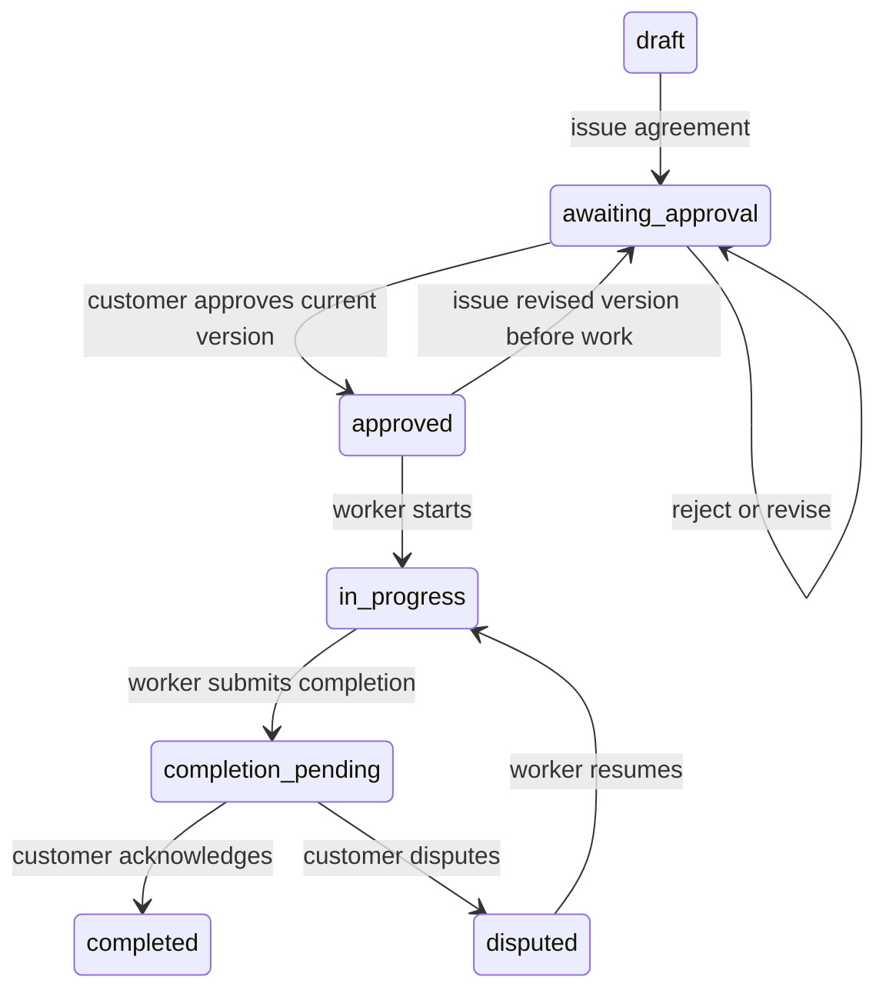

# Architecture

Main was a bootstrap; an unmerged MVP used Next.js and FastAPI. The final
implementation retains that framework and apps/api + apps/web structure, using
React 19, TypeScript, Next.js 16.4.5 App Router, i18next and Lucide; FastAPI, Pydantic 2,
SQLAlchemy 2 and Alembic on the backend. PostgreSQL 17 is the container database;
SQLite on a private local disk supports development and isolated tests.

Nginx proxies the Next.js Node server and `/api/v1` backend on one origin.
Only port 8080 is published by Compose. A production TLS terminator sits in front
of Nginx. Worker browser credentials use opaque, random, hashed server-side
sessions in HttpOnly cookies, with rotating refresh credentials and session-bound
CSRF tokens. There is no JWT parser or signing key to configure.

Next.js uses actual App Router pages and layouts, with a per-request script nonce
and dynamic rendering. The previous Vite iteration was replaced during MVP
reconciliation. A small navigation adapter shares accessible components with the
test harness; production routing uses next/link and next/navigation.

`app/auth.py` handles account/session routes. `app/jobs.py` handles worker routes;
`app/portal.py` handles customer capabilities. `services.py` centralizes ownership,
optimistic record locking, state transitions, attribution and financial summaries.
`storage.py` validates, decodes and re-encodes images and provides private local/S3
storage. `documents.py` builds paginated PDF records, with embedded OFL Noto fonts
and HarfBuzz shaping for supported Indic scripts. `mail.py` processes a durable
outbox; `cleanup.py` processes post-commit private blob deletion.

The frontend separates shared UI, query/state utilities, public/customer pages,
worker pages, API transport, translations and event translations. UI business
records always come from the API. Only language preference is stored in localStorage.
Images in the customer portal are fetched with capability headers into temporary
blob URLs, which are revoked on unmount.

Schema: users, sessions, action_tokens, rate_buckets, customers, jobs, agreements,
share_links, evidence, activities, payments, notifications, outbox and
blob_deletions. Ownership is explicit on jobs/customers; child records reference
jobs. All relationships use database foreign keys. Email, token digests,
agreement version per job, activity sequence per job and payment idempotency per
job have unique constraints. Money uses NUMERIC(14,2) and Decimal validation.

All job mutations take an optimistic revision lock, then write the change and
its attributed event in the same database transaction. This serializes agreement
decisions, completion responses and payment balance checks across API processes.
Activity sequence follows that revision, giving stable within-job chronology even
when actions share a timestamp. A losing concurrent request returns 409.

State machine:

Agreements have no update/delete endpoint. A revision creates another immutable
version and resets job approval. Shared links retain their exact agreement binding;
old links can display history but cannot approve newer versions or completion.
Customer possession identifies a capability, not an independently verified person.

Timestamp values are Unix UTC seconds; UI dates use Intl and the viewer's timezone.
Activity sequence provides exact ordering within a job. PDF labels are English,
while user text supports English, Hindi, Tamil and Kannada. Fonts derive from
https://github.com/notofonts/noto-fonts under the included OFL license.
